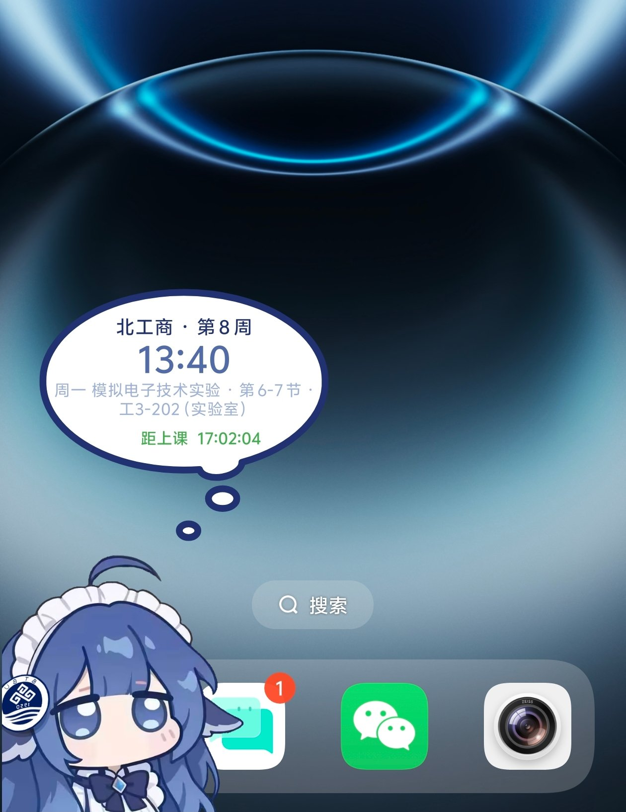

# 北工商桌宠 · Android

一只住在手机桌面上的**北工商主题桌宠**：本体是 DeepSeek 二创的「鲸鱼娘」，换上北工商校徽版形象，
顺手把**校园卡余额、校园网网费、课表**挂在它头顶的气泡里 —— 解锁就能看见，不用总去翻「掌上北工商」。

<p align="center">
  
  
</p>

> 桌宠住在**桌面**上（不是住在某个 App 里），悬浮在所有应用之上；数据来自掌上北工商同一套接口，
> **账号密码只存在本机**，没有第三方服务器中转。

> ### ⚠️ 免责与使用边界
>
> - 本项目**仅供个人学习**，仅用于查询**本人**的校园数据。
> - **请勿**用于：非本人账号、批量/高频访问、任何写操作（打卡、选课、缴费等）、商业用途、二次分发他人数据。
> - 接口是从官方 App 逆推所得，**没有任何官方授权**，随时可能变更或失效；数据准确性以「掌上北工商」为准。
> - 本项目为个人作品，与北京工商大学、DeepSeek 官方**均无隶属关系**。使用即表示你自行承担相应风险；若校方提出异议，项目将立即下架。

---

## 一、它能做什么

### 桌宠本体

| 能力 | 说明 |
|---|---|
| 悬浮桌面 | 前台服务 + 悬浮窗，不属于任何 App，切到哪都能看见 |
| 拖拽 / 甩抛 | 跟手拖动；快速甩出会抛物线飞出、撞边反弹、落地摩擦减速 |
| 贴边躲藏 | 拖到边缘自动贴边，静置一会儿缩进去只露半个身子，碰一下就探出来 |
| 自动朝向 | 在左半屏朝左看、右半屏朝右看，跟着位置实时翻面 |
| 点一下 | **按压变瘪**（纵向压 12%、横向胀 5%，220ms 弹性回弹）＋「拍一拍」音效 |
| 点很快 | 音效也不会被截断：抬手音会排到按压音结束前 40ms 再响 |
| 长按 | 动作菜单：让她说句话 / 回到初始位置 / 翻转朝向 / 收起来 |
| 台词气泡 | 内置 320 句，按情境弹（开机、被连点、被甩、贴边、早晚深夜、久置）；5 秒自动收 |
| 桌面挂件 | 3×2 小部件：时钟 + 第几周 + 余额 + 下一节课 + 倒计时 |
| 锁屏显示 | 可选，开无障碍服务后连锁屏上也能看见她 |
| 其他 | 开机自启、后台保活、1–3 只同时上桌、大小 80–360dp |

### 北工商数据

| 数据 | 来源（掌上北工商同款接口） |
|---|---|
| 校园卡余额 | `infoCampus/playCampus/getAllPurposeCard.do` |
| 校园网网费 | `interface/rest/http/jf/getNetUser.htm` |
| 课表（含实验课） | `jwCampus/course/getCourse.do` + `getCourseTimeConfig.do` |
| 教学周 | `oaCampus/sc/getXnXq.do`（学期开始日 → 第 N 周） |

- **头顶气泡**：点一下宠物弹出，三页可翻 —— 下一节课 / 校园卡余额 / 网费余额，底部绿色药丸是倒计时（距上课或距下课）
- **课表按周取数**：教务是「按周给课表」的，问第几周才给第几周的安排（第 9 周才出现的实验课也能拿到）；
  今天这周没课了会顺手把下一周也拉一份
- **周次三保险**：学期开始日 → 同步锚点 → 老缓存，任何一环坏掉都不会把周次算飞；设置页还能手动 ±1 周

---

## 二、下载安装

到 [Releases](../../releases) 下载最新 APK，详细步骤见 **[docs/INSTALL.md](docs/INSTALL.md)**（含各厂商保活设置、常见问题）。

三步上手：

1. 安装后打开 App，授予**悬浮窗**与**通知**权限
2. 填学号 + 密码 → 点「登录并同步」（密码只存手机本地）
3. 点 **「🐟 放出来」**

---

## 三、从源码构建

```bash
# 需要 JDK 17 + Android SDK 34
echo "sdk.dir=/path/to/android-sdk" > local.properties
./gradlew :app:assembleDebug
# 产物：app/build/outputs/apk/debug/app-debug.apk
```

签名用的是仓库里的 `keystore/btbu-debug.jks`（自签名，口令 `btbu2026`），
这样每版都能**直接覆盖安装**、不用先卸载。想换成自己的签名，改 `app/build.gradle.kts` 的 `signingConfigs` 即可。

CI：`.github/workflows/build.yml` 会在 push 到 `main` 时自动构建，产物传到 Actions 的 artifact。

## 四、代码结构

```
app/src/main/java/com/dshpet/android/
├─ PetService.kt       前台服务：悬浮窗管理 + 帧循环 + 长按菜单 + 气泡/挂件联动
├─ Pet.kt              单只宠物：绘制 / 触摸 / 物理 / 漫游 / 朝向 / 压扁
├─ Physics.kt          物理（dsh-pet physics.ts 逐行移植）
├─ PetConfig.kt        形象与动画配置
├─ Sfx.kt              点击音效（按压音 + 抬手音排期）
├─ LockOverlay.kt      锁屏覆盖层
├─ PetA11yService.kt   无障碍服务（只为拿锁屏级悬浮窗）
├─ MainActivity.kt     设置页：账号 / 教学周校正 / 大小 / 音效 / 只数
├─ Lines.kt            台词库（内置 320 句 + 可视化编辑）
└─ btbu/               北工商数据
   ├─ Tron.kt          请求信封 + 签名（md5）
   ├─ BtbuApi.kt       登录 / 课表 / 网费 / 一卡通 / 学期
   ├─ BtbuParse.kt     响应解析（字段名来自真实抓包）
   ├─ BtbuStore.kt     缓存 + 周次计算 + 派生（当前课 / 下一节 / 倒计时）
   ├─ BtbuSync.kt      后台同步
   ├─ ThoughtBubble.kt 手绘气泡（几何照抄上游 SVG）
   ├─ BtbuWidgetProvider.kt  桌面挂件
   └─ BtbuHud.kt       设置页/挂件共用的状态行
```

## 五、许可与署名

- **代码**：MIT，见 [LICENSE](LICENSE)
- **气泡外形**：取自社区插件 [`dsh-whale-widget`](https://github.com/MeteorNOX/DeepSeek-Balance-Whale-Widget)
  的 SVG pathData（**MIT**, Copyright (c) 2025 MeteorNOX），`res/drawable/btbu_bubble.xml` 逐字符照抄
- **点击音效**：同上，取自该插件的「音效1」预设（`res/raw/tap_press.mp3` / `tap_release.mp3`）
- **桌宠形象**：北工商校徽版立绘，由项目作者绘制/整理，随仓库分发；校徽版权归北京工商大学所有
- **物理引擎**：`Physics.kt` 是 [dsh-pet](https://github.com/PC2005-cloud/dsh-pet) 的逐行移植，
  其素材声明「允许开源使用、禁止商用」，因此本仓库不含上游那 106 段动画素材
- 本项目是学生自制的**非官方**作品，与北京工商大学、DeepSeek 官方均无隶属关系
